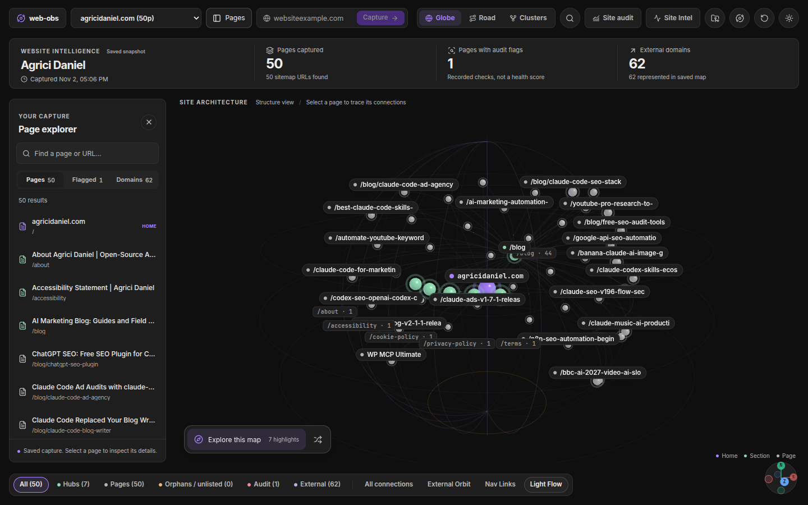
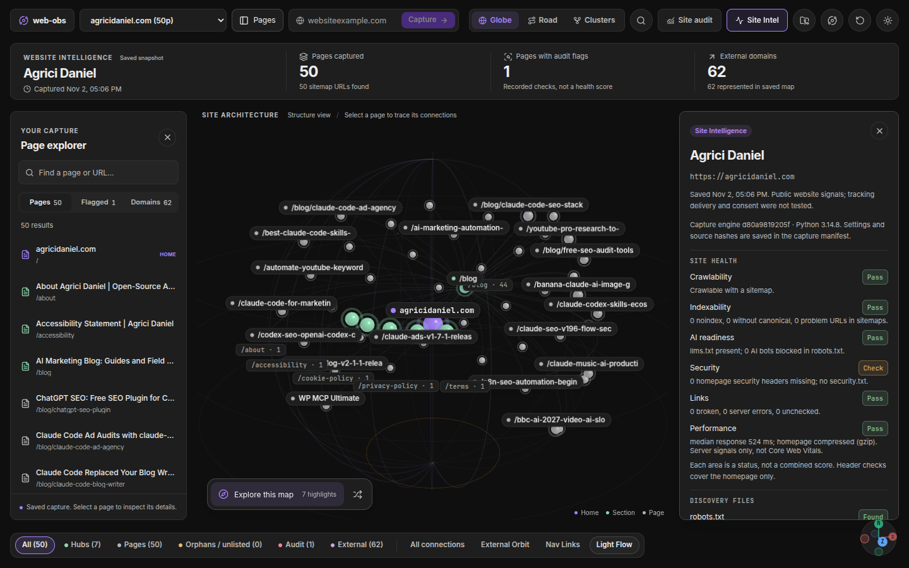
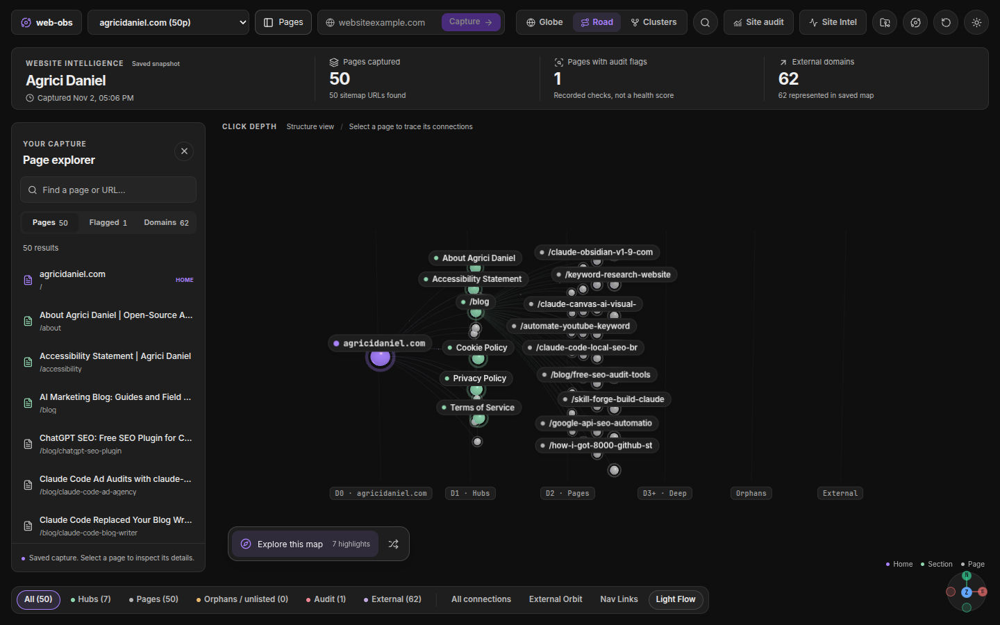
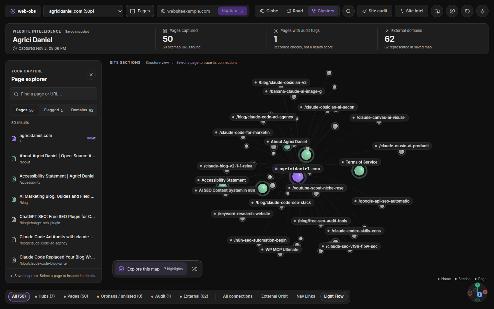
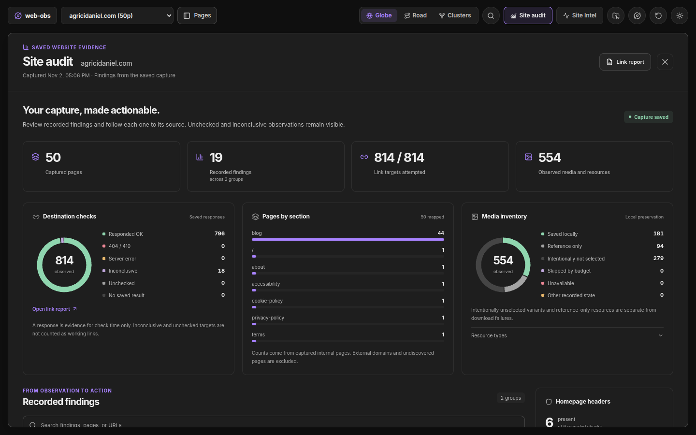
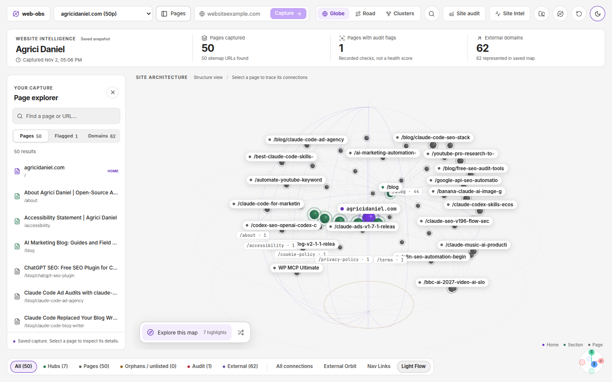

# Web-Obs

Turn any website into notes in your Obsidian vault, then explore it as a 3D map.

Type a domain. Web-Obs reads the public pages, saves each one as a clean Markdown note, and draws the whole site as an interactive globe so you can see how everything connects.



## What you get

- **A note for every page.** Clean Markdown with images saved locally, so your notes work offline.
- **A 3D site map.** Your website sits at the center. Pages, sections and outside links orbit around it. Switch between Globe, Road and Clusters views.
- **A health check.** One card shows how crawlable, searchable, AI ready, secure and fast the site looks, and which links are broken.
- **A files checklist.** See at a glance whether the site has a sitemap, robots.txt, llms.txt, security.txt and similar files, with a starter version to copy for any that are missing.
- **A site audit.** Charts and a findings list that point back to the page behind each result: duplicate and thin pages, internal links to fix, link opportunities, conflicting canonicals, structured data gaps, certificate and header problems, and more.
- **A task list.** Every finding becomes a checkbox in `_tasks.md`. Your ticks survive the next capture, and tasks close by themselves once the problem is gone.
- **A browser sample.** Up to five pages open in a headless browser for lab timings, automated accessibility rules, screenshots and the third parties that load before anyone clicks.
- **Site comparison.** Put two captured sites side by side in one note.



## Private by design

Everything runs on your computer. There is no account, no tracking, no AI service and no API key. Web-Obs only talks to the website you ask it to capture, and to the links found on it when it checks them. The one exception is the optional email DNS check, which asks your own DNS resolver about the domain; you can turn it off in settings. Your notes stay in your vault.

## Before you start

Web-Obs needs **Python 3.14 or newer** on your computer. It does not install anything for you, so set it up once:

```bash
python3.14 -m venv ~/web-obs-python
~/web-obs-python/bin/pip install requests beautifulsoup4 lxml
```

Three optional packages unlock extra checks: `dnspython` (email DNS), `pyspellchecker` (spell check) and `html5lib` (HTML validation). Install any of them the same way. Web-Obs works without them and says which checks were skipped.

Pages that need JavaScript to show anything are handled by an optional browser step. The same browser runs the browser sample. To turn it on, also run `~/web-obs-python/bin/pip install playwright` and then `~/web-obs-python/bin/playwright install chromium`. You can skip this and still capture most sites.

Web-Obs is built for Obsidian on desktop and does not work on mobile. It is tested on Linux, and its automated checks also pass on macOS. Windows is not fully tested yet: captures run, but image discovery has a known problem there. If something misbehaves on your system, please [open an issue](https://github.com/AgriciDaniel/web-obs/issues/new/choose).

## Install

Web-Obs is not in the Obsidian community list yet, so for now you install it by hand:

1. Download `main.js`, `manifest.json` and `styles.css` from the latest [release](../../releases).
2. Put them in a folder named `web-obs` inside `YOUR-VAULT/.obsidian/plugins/`.
3. In Obsidian, open **Settings, Community plugins**, and turn on **Web-Obs Site Globe**. On first start Web-Obs unpacks its capture engine next to these files. You do not need to copy anything else.
4. Open the Web-Obs settings and set **Python executable** to the one you just made, for example `~/web-obs-python/bin/python3`.

## Your first capture

1. Click the globe icon in the left ribbon.
2. Type a website address, such as `example.com`.
3. Press **Capture**.

When it finishes, your notes appear in `sites/example.com/` and the map opens. Click any page on the map to see its details, or press **Site Intel** for the health card.

Stuck? Run **Web-Obs: Run diagnostics** from the command palette. It checks your setup and tells you how to fix anything that is wrong.

## A closer look

| | |
| --- | --- |
|  |  |
| **Road** follows the click path from the homepage outward. | **Clusters** groups pages by section. |
|  |  |
| **Site audit** turns the capture into charts and findings. | **Light and dark** themes, following Obsidian or your choice. |

## Good to know

- Web-Obs follows each site's robots.txt, honours `Crawl-delay`, backs off when a site answers 429 or sends `Retry-After`, and identifies itself honestly as `Mozilla/5.0 (compatible; WebObs/<version>; +<info page>)`. It captures up to 250 pages unless you change it. Site owners can read what it sends and how to control it in [docs/CRAWLER.md](docs/CRAWLER.md).
- A capture shows what a visitor could reach. It is not a full SEO score. Browser timings are lab numbers from one load on your computer, not Core Web Vitals field data, and the accessibility rules are automated checks, not a full audit.
- Capturing again never overwrites notes you edited. Fresh versions are saved for you to review.
- Only capture sites you are allowed to read, and respect their terms.

## More

- [Troubleshooting](docs/TROUBLESHOOTING.md)
- [Technical reference](docs/TECHNICAL.md) for how capture, storage and checks work
- [Changelog](CHANGELOG.md)
- [Contributing](CONTRIBUTING.md) and [Security](SECURITY.md)

## License

[MIT](LICENSE). Made by [Daniel Agrici](https://agricidaniel.com).
