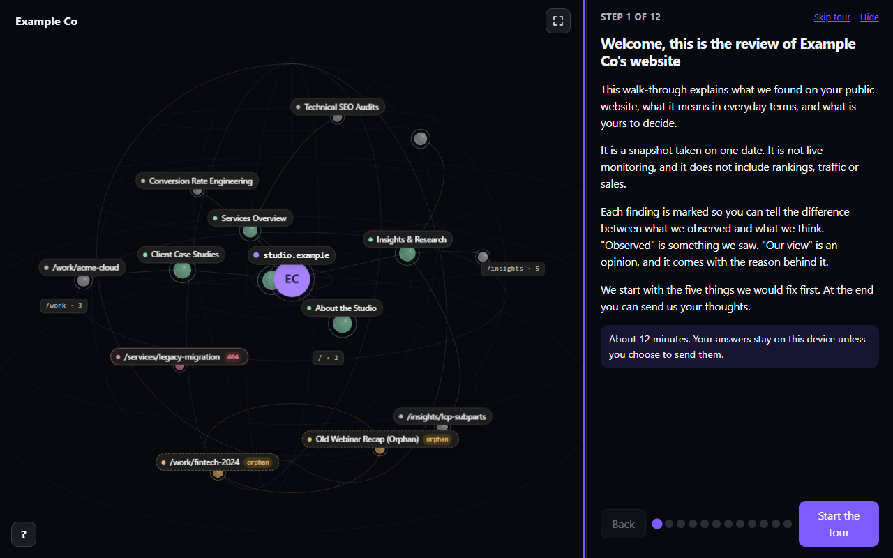
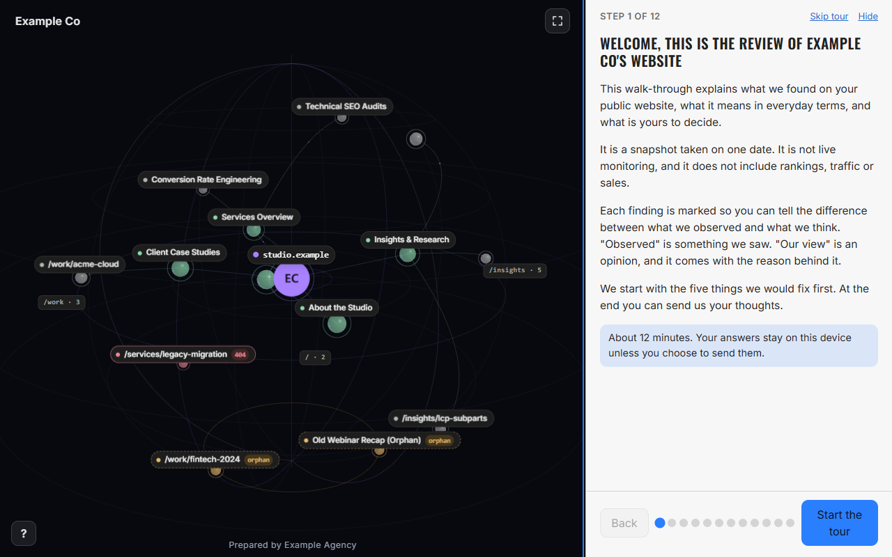
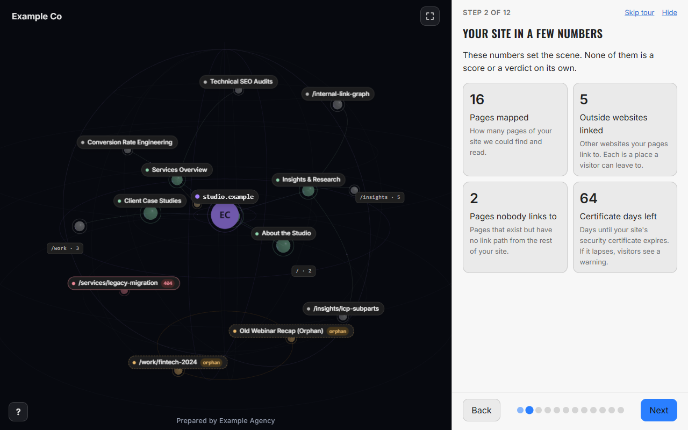
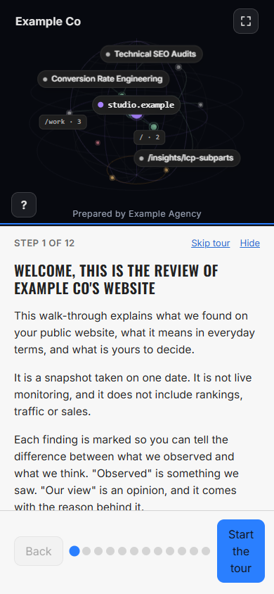

# Client reports and capture archives

Open a captured site's **Site Audit** in Obsidian desktop to find **Publish** and **Archive**. These controls are unavailable for the preview site and the standalone browser app.

## Publish

Review the audit findings, press Publish, enter the approver's name, and approve the report. The report includes page titles, public URLs, the site map, audit findings and the approver's name. It excludes vault note paths, raw page text, resource inventories and agency notes. Review the site and findings before sharing them.

In **Settings, Web-Obs, Client reports**, choose a destination:

- **Client reports folder:** a full path for a local JSON export under a random name. This alone does not create a private server link.
- **Publish target:** your report server's HTTPS base address, such as `https://audit.example.com`. Web-Obs appends `/ingest/v1/reports`. The server must implement the `webobs.client-report` v1 contract and return a link, link ID and expiry. The viewer and ingestion service are separate software; the plugin does not deploy them.
- Advanced targets also accept `host:/absolute/folder` over SSH or a full local folder path. These write `reports/` and `registry/` in the server's layout. Set **Report viewer address** to receive a link for these targets. SSH uses your existing configuration and agent, requires a known host key, and cannot prompt for a password.

A publish target takes precedence over the client reports folder. When neither is configured, Publish opens a destination dialog. Remembering a destination stores only its address or folder path.

The **Publish secret** authorizes HTTPS ingestion. Optional **Cloudflare Access ID** and **Cloudflare Access secret** supply a service token where the server requires it. Values entered in settings go to Obsidian's secret storage, when supported, and are excluded from plugin settings. The ingest secret can also be entered for the session through a prompt. Older Obsidian versions without secret storage need the explicit environment option for Cloudflare credentials.

**Also read secrets from environment variables** is off by default. When enabled, it permits `WEBOBS_INGEST_SECRET`, `CF_ACCESS_CLIENT_ID` and `CF_ACCESS_CLIENT_SECRET` as fallbacks. Do not put credentials in a URL or a vault note.

Stored credentials take priority. An available environment ingest secret, when explicitly enabled, is used before asking for a session secret.

HTTPS requests have a timeout and do not follow redirects. Plain HTTP is accepted only for localhost or `127.0.0.1` development targets. Push publishing requests a 72-hour link. Copy the returned link before closing the dialog. Anyone holding a valid private link can read its report until it expires or is revoked on the report server. Archiving a local capture does not revoke a published link.

## A report with a look

A client report can carry an optional **look**: a short, checked list of style slots under `styles`. A report without `styles` is exactly as before, and the viewer shows its built in look. The person chooses the look in the Publish dialog (the **Look** choice, with profile files in the vault); that side is explained in [Publish with a look](PUBLISH-STYLES.md). This section covers what travels, its limits and what each server version needs. The destination, publish target, Publish secret and Cloudflare Access settings above are unchanged and apply to a report with a look as they do to any report.

### How a report looks with and without a look

The same synthetic report ("Example Co"), published through the plugin's own publish code to a report server at 0.1.7 and opened in the viewer. Without a look the viewer shows its built in dark look; with a look it takes the accent, a light card with dark text, Oswald headings, Inter body text and the agency footer line. The dark map stage never changes.









### What the look contains and its limits

| Slot | Value | Limit |
| --- | --- | --- |
| `accent`, `secondary`, `link`, `text`, `muted`, `surface` | a color | `#rrggbb` only |
| `cardText`, `cardMuted` | the text and small text on cards | `#rrggbb` only; must reach 4.5 to 1 on `surface` |
| `headingFont`, `bodyFont` | a bundled font name | `Oswald` or `Inter` only; no font file travels, the server has them |
| `headingCase` | how headings are written | `uppercase`, `none`, `capitalize` or `lowercase` |
| `name` | the agency name (browser tab title) | plain text, up to 80 characters |
| `footerText` | one line naming who prepared the report | plain text, up to 120 characters |

- The whole look is at most 4096 characters. A name that is not in the table is refused and named in the message (a typo such as `acent` is caught).
- There is no slot for the page background or the 3D map, so a look cannot change them.
- A look whose card color the text cannot read is refused with both colors and the numbers, for example `cardText: #323334 on the card #d52924 reaches only 2.52:1 and needs 4.5:1. Use light text on this card, for example #ffffff (5.0:1).` The plugin runs the same check before anything is sent.
- Text values are plain text: no markup, links, control characters or invisible characters.

### An example

A look (synthetic values):

```json
{
  "accent": "#2a7fff",
  "surface": "#f7f7f7",
  "cardText": "#222222",
  "headingFont": "Oswald",
  "bodyFont": "Inter",
  "headingCase": "uppercase",
  "name": "Example Agency",
  "footerText": "Prepared by Example Agency"
}
```

The request the plugin sends to the publish target is the same `POST` to `/ingest/v1/reports` as before, with the same headers, and one JSON body with exactly two keys:

```json
{
  "styles_3f9a1c5d7e20": { "accent": "#2a7fff", "surface": "#f7f7f7" },
  "data_3f9a1c5d7e20": { "format": "webobs.client-report", "version": "1.1" }
}
```

Both names end in the same short hash of the look, so the server can pair them. The `data_` part is the report without its `styles` (shown shortened here). The integrity seal covers the report without `styles`, so the look can travel as its own part.

### Which report app version is needed

- **The paired request needs report app 0.1.4 or later** on the server and the ingest. An older server does not know it and answers that it is not a client report. For a report with a look the plugin turns that into a plain message: update the report server and the ingest to 0.1.4, or publish with the Default look. A report with the Default look is sent as a plain report and works with any server.
- **Text on cards (`cardText`, `cardMuted`) needs 0.1.6 or later.** An older server refuses the unknown names.
- **The shared check the plugin copies is the 0.1.7 code.** It draws light cards opaque, makes the small label chips readable and nudges built in colors on a card that is not dark. 0.1.7 changes how a look is drawn, not what a server accepts, so an older server (0.1.4 or later) accepts the same looks.
- The copy lives in `src/report/styles/` and is not edited here. `scripts/verify-report-look.mjs` compares each file with the sha256 of the report app's file, so a copy that drifts fails.

### SSH and local folder routes

These routes do not use the two part request. The report is written as one file with the look inside it under `styles`, and the server checks the look again when it serves the report. Everything else about these routes is as described under Publish above.

### What is and is not sent

- **Sent:** only the checked slots in the table, inside the report. Anyone who holds the report link can see them, including the agency name and the footer line, so put no private notes or contact details in a look.
- **Not sent:** profile files as such, anything in a profile that is not a slot (voice, notes, logo paths, other colors), file paths, font files, and any secret. The Publish secret and the Cloudflare values go only in request headers, as before.
- **Checked before sending:** a look that does not pass never leaves the computer.
- A look travels with its report. Links published earlier keep the look they were published with; publish again to change it.

## Archive and restore

Archive first lists the exact folders and file counts. Type the saved site's ID to confirm. Finish captures or wait for cancellation to complete before archiving. Closing a capture pane does not bypass that wait. A capture awaiting recovery also blocks Archive. Do not run a separate command-line capture against the same vault during an archive.

The plugin moves the site's active capture, history, preserved proposals and any matching site folders inside staged transactions to a unique folder beneath `.web-obs/trash/`. Other sites are preserved. Directory links are refused, and links inside capture files are moved without following them.

All open Web-Obs panes refresh after an archive, including panes displaying that site. Confirmation forms can scroll within short panes.

Each archive contains **REMOVED.txt** with the original destinations. To restore, close Web-Obs views, make sure no new capture occupies those destinations, and move each listed folder back to its original path. Reopen the view to refresh its site list. Nothing in the archive is automatically deleted.

## Verification and origin

The Publish and Archive integration comes from gcollins808's supplied changes archive, SHA-256 `3d31d21ca7802fc8a6669c1f2884171f38dd2f60cff0442043374400d326e3d5`, with local archive and response-validation fixes. The separate report server was inspected at commit `dd17fcd50754549cd295c0ff47fdc3aec846d4e9`. Its private viewer source and deployment configuration are not included in this plugin.

`npm run verify` includes export privacy, archive recovery, publish target, secret-source and renderer checks. The optional cross-repository test uses synthetic data and loopback servers only:

```bash
REPORT_SERVER_DIR=/path/to/web-obs-client-report/apps/server node scripts/verify-export-ingest.mjs
```

It checks that a plugin-generated report is accepted by ingestion and served by the viewer server, and that a report with a look is sent as the two-part request (`styles_<hash>` and `data_<hash>`), accepted, and served with its look. Without that separate source checkout, the test reports an explicit skip. It does not verify a production host, Cloudflare configuration, real credentials, native GPU performance or human approval of report wording.

The dated [native integration acceptance record](NATIVE-INTEGRATION-ACCEPTANCE.md) covers the follow-up native application, capture, report viewer and regression checks.
